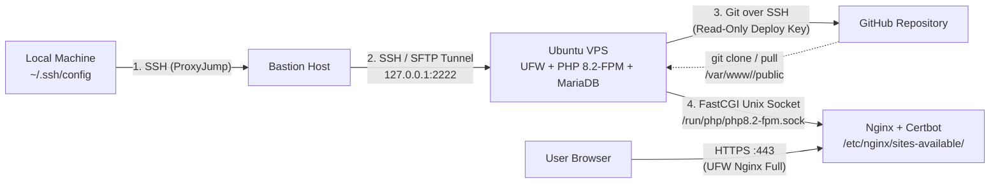

# VPS-Guide: Secure SSH → VPS → Nginx Deployment

A concise, security-first guide and template collection for deploying a PHP web application on an Ubuntu VPS. All three layers—**SSH**, **VPS (Ubuntu + UFW + PHP 8.2-FPM + MariaDB/Backups)**, and **Nginx (+ HTTPS)**—are wired together into one end-to-end workflow.

## Architecture: How the 3 Services Connect



## Shared Placeholders

Every guide and template in this repository uses the same placeholders. Replace them with your own values on your machine/server—**never commit real IPs, domains, usernames, keys, or passwords**.

| Placeholder | Meaning | Example |
| :--- | :--- | :--- |
| `<BASTION_IP>` | Bastion / jump host IP or hostname | `203.0.113.10` |
| `<BASTION_USER>` | SSH username on the bastion | `jumpuser` |
| `<VPS_IP>` | Target VPS IP address | `198.51.100.25` |
| `<VPS_USER>` | Non-root sudo username on the VPS | `deploy` |
| `<DOMAIN>` | Public domain name of the site | `example.com` |
| `<DB_NAME>` | MariaDB database name | `app_prod` |
| `<DB_BACKUP_USER>` | Dedicated least-privilege MariaDB backup user | `backup_user` |

## Step-by-Step Guide

1. **[01 — SSH Configuration & Hardening](docs/01-ssh.md)**
   - Bastion jump host (`ProxyJump`), direct VPS login, and localhost-only SFTP tunnel (`127.0.0.1:2222`).
   - Hardening `sshd` (`PermitRootLogin no`, `PasswordAuthentication no`).
   - Read-only GitHub Deploy Key on the VPS for `git clone` / `git pull`.
2. **[02 — VPS Provisioning, PHP 8.2-FPM & Secure Backups](docs/02-vps.md)**
   - Ubuntu updates, UFW firewall (`OpenSSH` first, then `Nginx Full`), and unattended security upgrades.
   - Hardened PHP 8.2-FPM (`cgi.fix_pathinfo=0`, `expose_php=Off`).
   - Least-privilege web directory (`/var/www/<DOMAIN>/public`) and automated backups via `~/.my.cnf` (`chmod 600`).
3. **[03 — Nginx Configuration & HTTPS (Certbot)](docs/03-nginx.md)**
   - Connecting Nginx to `/var/www/<DOMAIN>/public` and `unix:/run/php/php8.2-fpm.sock`.
   - Blocking `.git`, `.env`, and PHP execution in upload directories.
   - Enabling HTTPS with Let's Encrypt (`certbot --nginx`) and verifying the entire stack.

## Repository Structure

```text
VPS-Guide/
├── README.md
├── docs/
│   ├── 01-ssh.md
│   ├── 02-vps.md
│   └── 03-nginx.md
├── templates/
│   ├── ssh/
│   │   ├── client-config.example
│   │   └── vps-github-config.example
│   ├── nginx/
│   │   └── site.conf.example
│   └── db/
│       └── my.cnf.example
└── scripts/
    ├── backup_bd.sh
    └── backup_files.sh
```

## Security Principles Applied

- **Zero secrets in Git:** `.gitignore` blocks `.env`, SSH keys, `.my.cnf`, and backup dumps; only sanitized `.example` templates are tracked.
- **Least privilege everywhere:** non-root SSH user, read-only GitHub deploy key, `750`/`640` web permissions, `600` on SSH/DB credentials, `umask 077` on backups.
- **No passwords in CLI arguments:** MariaDB backups authenticate via `--defaults-extra-file=~/.my.cnf` so passwords never appear in `ps`.
- **Safe line endings:** `.gitattributes` enforces `LF` for all Linux scripts and configs.
